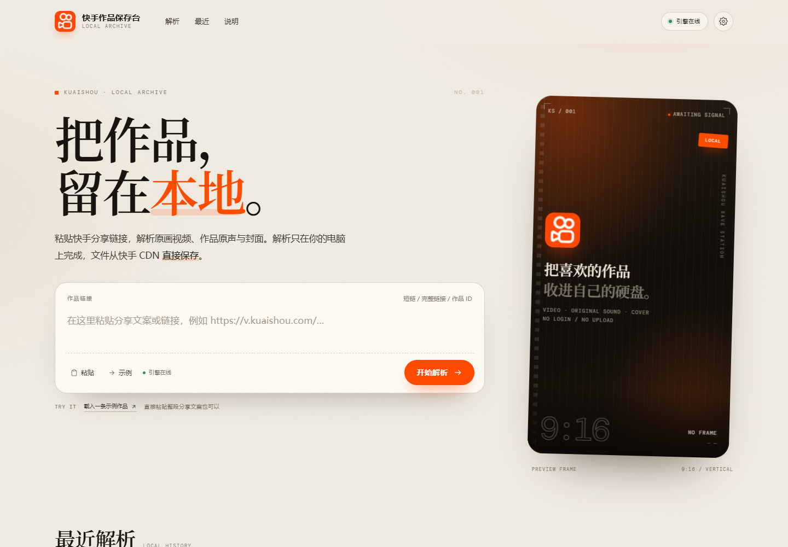
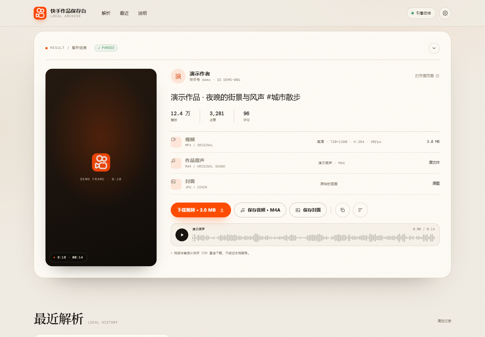
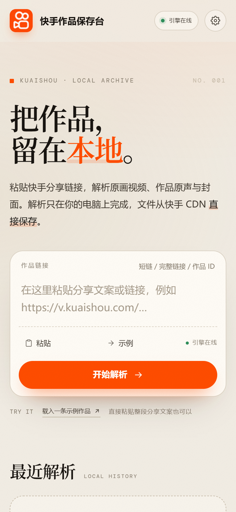

# 快手作品保存台 · Local Archive

一个在本地运行的小工具：粘贴快手分享链接，解析并保存**原画视频、作品原声、封面**。页面是单文件 HTML，解析由同目录下的 Python 本地引擎完成，不需要安装第三方依赖，也不需要登录快手账号。



## 快速开始

1. 安装 [Python 3.10+](https://www.python.org/downloads/)（安装时勾选 “Add Python to PATH”）。
2. 双击 `start.bat`，或在项目目录执行：

   ```bash
   python server.py
   ```

3. 浏览器打开 <http://127.0.0.1:8787>。

停止服务：在运行窗口按 `Ctrl + C`。

> 直接双击 `index.html` 也能打开完整界面；解析请求默认发往 `127.0.0.1:8787`，所以仍需要先启动本地引擎。页面右上角的“引擎在线/离线”会显示当前状态。

## 能做什么

- 支持 `v.kuaishou.com` 短链、`www.kuaishou.com/short-video/...` 完整链接、作品 ID，以及整段分享文案。
- 解析原画 MP4、作品原声 M4A、原始封面 JPG。
- 没有独立原声文件时，可以从视频音轨提取 WAV（浏览器内解码，不上传文件）。
- 下载前可预览视频、试听原声；解析记录只写入浏览器 `localStorage`。
- 桌面端与手机端自适应。





## 配置

| 配置项 | 位置 | 默认值 |
|---|---|---|
| `KS_PORT` | 环境变量 | `8787` |
| 解析端口 | `python server.py 8788` | 跟随参数 |
| API 地址 | 页面右上角引擎设置，或 `localStorage` 的 `ks.apiBase.v1` | 同源；`file://` 下为 `http://127.0.0.1:8787` |
| 自动打开浏览器 | `python server.py --open` / `start.bat` | 关闭 |
| 解析超时 | `server.py` 中 `fetch_page(..., timeout=25)` | 25 秒 |

## 不支持的场景

- 图集、直播回放；
- 私密、仅粉丝可见、已删除或需要登录才能查看的作品；
- 快手页面结构大改后，解析可能暂时失效，需要更新 `server.py` 里的提取逻辑。

## 项目结构

```
ks-dl/
├── index.html          单文件界面（HTML + CSS + JS）
├── server.py           本地解析引擎（Python 标准库）
├── start.bat           Windows 一键启动
├── start.sh            macOS / Linux 启动脚本
├── assets/             快手官方 favicon 与图标
├── preview/            页面截图
├── LICENSE             MIT
├── .gitignore
└── README.md
```

## 解析接口

本地引擎只监听 `127.0.0.1`，提供两个接口：

```http
GET /api/health
→ {"ok": true, "name": "ks-local-engine", "version": "1.0.0", "python": "3.12.10"}

POST /api/parse
Content-Type: application/json

{"url": "https://www.kuaishou.com/short-video/xxxxxxxx"}
```

成功时返回的字段：

```json
{
  "ok": true,
  "photoId": "3xA1b2C3d4E5f6",
  "caption": "作品文案",
  "author": {"name": "作者", "avatar": "https://...", "kwaiId": "..."},
  "cover": "https://...",
  "duration": 12.0,
  "stats": {"view": 12345, "like": 678, "comment": 12, "share": 0},
  "video": {
    "url": "https://...mp4",
    "label": "高清",
    "width": 720,
    "height": 1280,
    "codec": "H.264",
    "size": 2500000,
    "frameRate": 30
  },
  "audio": {"url": "https://...m4a", "name": "作品原声", "artist": "作者"},
  "sourceUrl": "https://www.kuaishou.com/short-video/xxxxxxxx"
}
```

失败时返回 `{"ok": false, "message": "……"}`。

## 常见问题

**右上角显示“引擎离线”**
先运行 `python server.py`；如果已经运行，点右上角的引擎状态，检查 API 地址是否为 `http://127.0.0.1:8787`。

**端口 8787 被占用**
换一个端口启动：

```bash
python server.py 8788
```

然后在页面的引擎设置里把 API 地址改成 `http://127.0.0.1:8788`。

**提示没有识别到作品链接**
确认链接来自快手分享面板，或直接粘贴整段分享文案。作品 ID 也可以直接作为输入。

**下载没有开始**
部分 CDN 节点会拒绝浏览器直接写文件，此时页面会打开源文件，右键“另存为”即可。解析出的媒体地址有时效，过期后重新解析一次。

**保存的音频只有伴奏**
快手作品的“作品原声”字段由作者发布时决定；如果需要完整音轨，点“提取音频 · WAV”，它会把视频里的声音解码出来。

## 说明

- 解析对象是快手公开页面；不读取登录态、不调用账号接口。
- 媒体文件从快手 CDN 直接传输到浏览器，本地服务只负责解析页面信息。
- 页面中的快手图标来自其公开 favicon，仅用于标识解析对象；本项目与快手官方无关。

## License

[MIT](LICENSE) © 2026 grandexecuti

